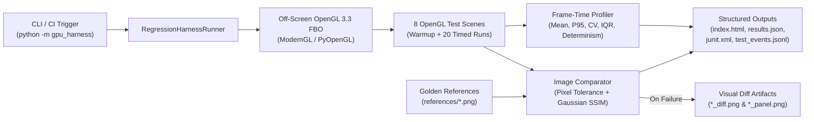
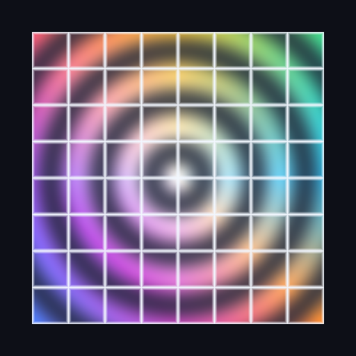
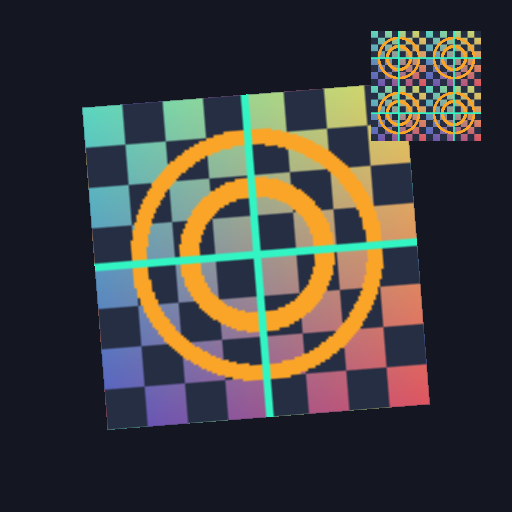
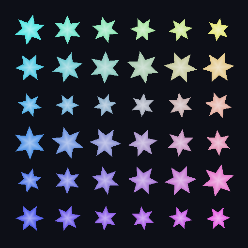
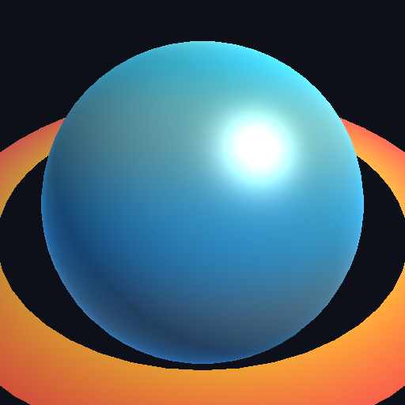
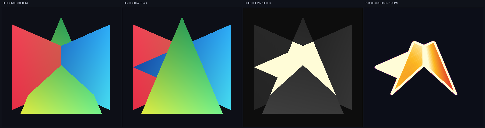
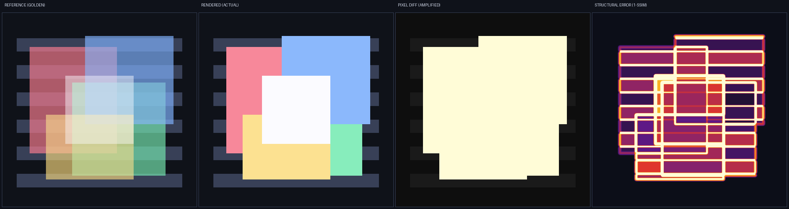
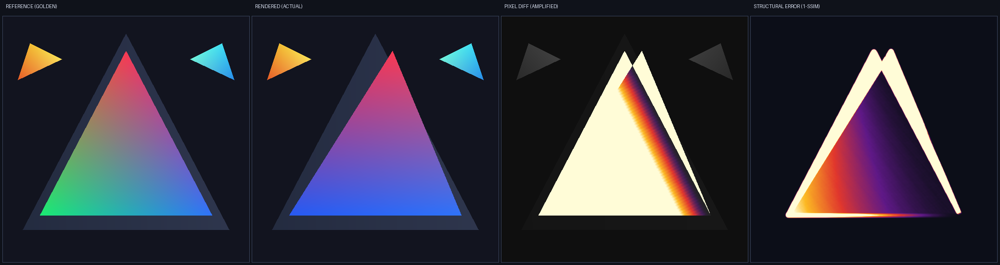

# GPU Render Regression Test Harness

An automated **off-screen OpenGL 3.3 Core graphics regression and frame-time stability testing framework** built with **Python**, **ModernGL**, **PyOpenGL**, **NumPy**, **SciPy**, **GitLab CI**, and **GitHub Actions**.

---

## Why This Project Exists

In GPU driver development, game engines, and real-time 3D visualization pipelines, code or shader changes can compile and execute with `exit code 0` while silently introducing visual corruption (broken depth occlusion, disabled alpha blending, flipped surface normals, UV offsets) or frame-time jitter.

Simple byte-for-byte image hashing (`MD5`/`SHA-256`) fails in graphics testing because minor floating-point rounding (`±1/255`) across GPU architectures causes false positives. This harness solves both problems:

1. **Headless Off-Screen Rendering**: Renders **8 deterministic 2D/3D OpenGL 3.3 Core test scenes** directly into `512×512` `RGBA8` + `24-bit Depth` Framebuffer Objects (FBOs) without opening a window.
2. **Dual-Backend Parity**: Supports both **ModernGL** (`--backend moderngl`) and **PyOpenGL** (`--backend pyopengl`) with verified `SSIM = 1.00000` cross-backend equivalence.
3. **Tolerance + Perceptual SSIM Comparison**: Combines per-pixel channel tolerance with Gaussian-windowed **Structural Similarity Index Measure (SSIM)**, **PSNR**, **MAE**, and **RMSE** to tolerate benign 1-bit driver rounding while immediately catching structural rendering bugs.
4. **Automated Failure Diff Visualization**: Generates `10×` amplified Inferno/Magma error heatmaps and **4-panel diagnostic strips** (`Reference | Rendered | Amplified Pixel Diff | 1 - SSIM Structural Error`) whenever a scene fails.
5. **Frame-Time Performance & Stability Profiling**: Separates shader compilation warm-up frames from steady-state timed iterations (`Mean`, `Median`, `P95`, `P99`, `StdDev`, `CV`, `IQR`, `FPS`) and verifies **100% inter-frame pixel determinism**.
6. **Structured Telemetry & CI Artifacts**: Outputs machine-parseable **JSON Lines (`test_events.jsonl`)**, **JSON summary (`results.json`)**, **JUnit XML (`junit.xml`)**, and a **self-contained HTML dashboard (`index.html`)** with embedded Base64 images and inline SVG frame-time charts on every push.

---

## Architecture



---

## Off-Screen OpenGL 3.3 Test Scenes (`512×512`)

| `01_rgb_triangle` | `02_indexed_quad_uv` | `03_checker_texture_2d` | `04_alpha_blending_glass` |
| :---: | :---: | :---: | :---: |
|  |  |  |  |
| **Barycentric RGB Triangle**<br/>`GL_TRIANGLES`, `VBO`, `VAO`, smooth vertex color interpolation | **Indexed Quad UV Mesh**<br/>`glDrawElements`, `EBO/IBO` (`uint32`), procedural UV grid & rings | **2D Calibration Texture**<br/>`GL_TEXTURE_2D`, `sampler2D`, UV tiling, bilinear filtering | **Translucent Alpha Blending**<br/>`GL_BLEND`, `GL_SRC_ALPHA`, `GL_ONE_MINUS_SRC_ALPHA` |

| `05_depth_test_intersection` | `06_depth_and_blending_composite` | `07_instanced_primitives_grid` | `08_phong_shaded_sphere` |
| :---: | :---: | :---: | :---: |
|  |  |  |  |
| **3D Z-Buffer Intersection**<br/>`GL_DEPTH_TEST`, `GL_LESS`, 24-bit depth occlusion | **Multi-Pass Depth + Glass**<br/>Opaque pass (`depth_write=True`) + translucent pass (`depth_write=False`) | **Hardware Instanced Grid**<br/>`glDrawArraysInstanced` (36 rosettes), `glVertexAttribDivisor` | **3D Blinn-Phong Lit Sphere**<br/>Perspective MVP `mat4`, surface normals, specular & Fresnel rim light |

---

## Visual Regression Detection Showcase

When a shader or pipeline regression occurs (or is simulated via `--inject-regression`), the harness fails the build and saves a **4-panel diagnostic strip** (`Reference | Rendered | Amplified Pixel Diff | 1 - SSIM Structural Error`):

### 1. Depth Buffer Regression (`05_depth_test_intersection` — `GL_DEPTH_TEST` disabled, SSIM: `0.95171`, Diff Pixels: `11.519%`)


### 2. Alpha Blending Regression (`04_alpha_blending_glass` — `GL_BLEND` disabled, SSIM: `0.91556`, Diff Pixels: `50.558%`)


### 3. Vertex & Color Channel Regression (`01_rgb_triangle` — Vertex shifted & G/B swapped, SSIM: `0.94643`, Diff Pixels: `25.227%`)


---

## Benchmark & Verification Results

Measured on **Intel(R) UHD Graphics (`OpenGL 3.3.0 - Build 31.0.101.5186`)** at `512×512` resolution with `3` warm-up iterations and `20` timed iterations per scene (`184` total off-screen frames):

| Scene ID | Category | Golden Status | SSIM | Outlier Pixels | Mean Frame (ms) | P95 (ms) | CV | Stability |
| :--- | :--- | :---: | :---: | :---: | :---: | :---: | :---: | :---: |
| `01_rgb_triangle` | Triangles & Vertex Interpolation | **PASS** | `1.00000` | `0.000%` | `0.910` | `1.118` | `0.355` | `STABLE` |
| `02_indexed_quad_uv` | Indexed Geometry (EBO/IBO) | **PASS** | `1.00000` | `0.000%` | `0.972` | `1.071` | `0.102` | `STABLE` |
| `03_checker_texture_2d` | Textures & Filtering | **PASS** | `1.00000` | `0.000%` | `1.190` | `1.589` | `0.222` | `STABLE` |
| `04_alpha_blending_glass` | Blending & Compositing | **PASS** | `1.00000` | `0.000%` | `0.987` | `1.216` | `0.141` | `STABLE` |
| `05_depth_test_intersection` | Depth Testing (Z-Buffer) | **PASS** | `1.00000` | `0.000%` | `0.674` | `0.783` | `0.110` | `STABLE` |
| `06_depth_and_blending_composite` | Depth + Blending Pipeline State | **PASS** | `1.00000` | `0.000%` | `0.953` | `1.199` | `0.115` | `STABLE` |
| `07_instanced_primitives_grid` | Instanced Rendering | **PASS** | `1.00000` | `0.000%` | `0.760` | `0.903` | `0.115` | `STABLE` |
| `08_phong_shaded_sphere` | 3D Shading & Lighting | **PASS** | `1.00000` | `0.000%` | `1.388` | `1.982` | `0.239` | `STABLE` |

- **Overall Golden Suite Verdict:** `8 / 8 PASSED` | **Mean SSIM:** `1.00000` | **Mean Frame Time:** `0.979 ms` (`~1,021 FPS`) | **Total Duration:** `3.40 s`
- **Automated Test Suite (`pytest`)**: `5 passed` with **95% statement coverage** across `src/gpu_harness/`.

---

## Project Structure

```text
gpu-render-regression-harness/
├── .gitlab-ci.yml                  # GitLab CI headless OpenGL pipeline + artifact archiving
├── .github/workflows/ci.yml        # GitHub Actions headless OpenGL workflow
├── pyproject.toml                  # Package metadata, CLI entry point, and pytest config
├── requirements.txt                # Runtime & test dependencies
├── README.md                       # Documentation, benchmarks, and usage guide
├── references/                     # Stored golden reference PNG images (01..08)
├── reports/                        # Generated reports, diffs, and structured logs
│   ├── index.html                  # Self-contained HTML report (Golden Passing Suite)
│   ├── results.json                # Machine-readable JSON run summary
│   ├── junit.xml                   # JUnit XML test report for CI integration
│   ├── logs/test_events.jsonl      # Structured JSON-Lines event stream
│   ├── rendered/                   # Off-screen rendered PNG frames
│   ├── diffs/                      # Amplified diff heatmaps & 4-panel comparison strips
│   └── regression_showcase/        # Demo failure run showing caught regressions & diff artifacts
├── src/gpu_harness/
│   ├── __init__.py
│   ├── __main__.py                 # Module entry point (`python -m gpu_harness`)
│   ├── backends.py                 # ModernGL & PyOpenGL off-screen FBO backends + shader cache
│   ├── cli.py                      # CLI (`run`, `generate-references`, `list-scenes`)
│   ├── comparator.py               # Pixel tolerance, Gaussian SSIM, PSNR, and diff heatmap builder
│   ├── config.py                   # Configuration dataclasses (Harness, Tolerance, Performance)
│   ├── logger.py                   # Structured JSONL, JSON, and JUnit XML exporters
│   ├── profiler.py                 # Frame-time statistical stability analyzer
│   ├── reporter.py                 # Jinja2 HTML report + inline SVG frame-time chart generator
│   ├── runner.py                   # End-to-end regression test orchestrator
│   └── scenes.py                   # 8 OpenGL 3.3 test scenes + fault injection modes
└── tests/
    └── test_harness.py             # Unit, cross-backend parity, and integration test suite
```

---

## Getting Started (Step-by-Step Instructions)

### 1. Clone & Set Up Virtual Environment

**Windows (PowerShell):**
```powershell
git clone <YOUR_GITHUB_REPO_URL>
cd gpu-render-regression-harness
python -m venv venv
.\venv\Scripts\Activate.ps1
pip install -r requirements.txt
```

**Linux / macOS (Bash):**
```bash
git clone <YOUR_GITHUB_REPO_URL>
cd gpu-render-regression-harness
python3 -m venv venv
source venv/bin/activate
pip install -r requirements.txt
```

### 2. Run the Full GPU Render Regression Suite

**Windows (PowerShell):**
```powershell
$env:PYTHONPATH="src"
python -m gpu_harness run --backend moderngl --warmup 3 --iterations 20 --save-all-diffs
```

**Linux / macOS (Bash):**
```bash
PYTHONPATH=src python -m gpu_harness run --backend moderngl --warmup 3 --iterations 20 --save-all-diffs
```

### 3. Run with the PyOpenGL Backend

```powershell
$env:PYTHONPATH="src"
python -m gpu_harness run --backend pyopengl --warmup 3 --iterations 20
```

### 4. Simulate Shader / Pipeline Regressions (Generate Failure Diff Images)

Inject intentional bugs into specific scenes (or pass `--inject-regression all`) to verify failure detection and inspect the generated diff heatmaps:

```powershell
$env:PYTHONPATH="src"
python -m gpu_harness run `
  --inject-regression 01_rgb_triangle 04_alpha_blending_glass 05_depth_test_intersection `
  --output-dir reports/regression_showcase
```

### 5. View the Interactive HTML Reports

```powershell
# Windows
start reports\index.html
start reports\regression_showcase\index.html
```

### 6. Run the Automated Test Suite (`pytest`)

```powershell
$env:PYTHONPATH="src"
python -m pytest tests/ -v --cov=gpu_harness --cov-report=term-missing
```

---

## CLI Options Reference

```text
usage: gpu-harness run [-h] [--backend {auto,moderngl,pyopengl}]
                       [--width WIDTH] [--height HEIGHT]
                       [--references-dir REFERENCES_DIR] [--output-dir OUTPUT_DIR]
                       [--scenes [SCENES ...]] [--warmup WARMUP]
                       [--iterations ITERATIONS]
                       [--pixel-tolerance PIXEL_TOLERANCE]
                       [--max-diff-ratio MAX_DIFF_RATIO] [--min-ssim MIN_SSIM]
                       [--frame-budget-ms FRAME_BUDGET_MS]
                       [--inject-regression [INJECT_REGRESSION ...]]
                       [--update-references] [--no-auto-reference]
                       [--save-all-diffs]
```

| Flag | Default | Description |
| :--- | :--- | :--- |
| `--backend` | `auto` | Off-screen OpenGL backend (`moderngl`, `pyopengl`, or `auto`) |
| `--width`, `--height` | `512`, `512` | Off-screen FBO dimensions in pixels |
| `--warmup` | `3` | Warm-up renders per scene (excluded from steady-state frame stats) |
| `--iterations` | `20` | Timed render iterations per scene for stability profiling |
| `--pixel-tolerance` | `0.01` | Normalized per-channel pixel tolerance in `[0.0, 1.0]` (~`2.5 / 255`) |
| `--max-diff-ratio` | `0.001` | Max fraction of pixels allowed to exceed `--pixel-tolerance` (`0.1%`) |
| `--min-ssim` | `0.990` | Minimum acceptable Gaussian-windowed RGB SSIM score |
| `--frame-budget-ms` | `33.33` | Target maximum mean frame time budget in milliseconds |
| `--inject-regression` | `None` | Scene IDs (or `all`) into which shader/pipeline bugs are injected |
| `--update-references` | `False` | Overwrite stored golden reference PNGs with newly rendered frames |
| `--save-all-diffs` | `False` | Emit `_diff.png` and `_panel.png` strips even for passing scenes |

---

## CI/CD Integration (GitLab CI & GitHub Actions)

Both [`.gitlab-ci.yml`](.gitlab-ci.yml) and [`.github/workflows/ci.yml`](.github/workflows/ci.yml) are included and configured to run automatically on every push:
- Installs headless Mesa OpenGL (`xvfb`, `libgl1-mesa-dri`, `llvmpipe` software rasterizer with OpenGL 3.3 Core override).
- Runs the `pytest` unit & cross-backend parity test suite with coverage.
- Executes the 8-scene GPU Render Regression Harness (`20` iterations/scene) plus the regression-injection showcase.
- Archives `reports/index.html`, `reports/regression_showcase/index.html`, `reports/results.json`, `reports/junit.xml`, `reports/logs/test_events.jsonl`, and all rendered/diff PNGs as pipeline artifacts.
